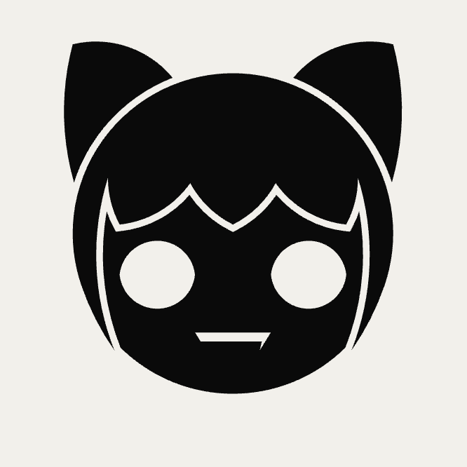
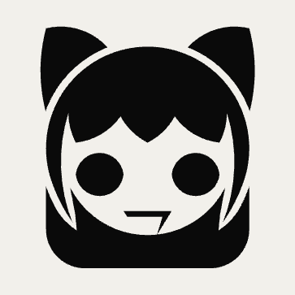

# rob-janoff-design

An [Agent Skill](https://agentskills.io/specification) that makes an AI agent design logos, icons and monograms with Rob Janoff's methodology from *Taking a Bite out of the Apple*:

1. Do your homework: business, audience, USP.
2. Abstract the shape: silhouette, cross-section, scale relation.
3. Add "a wink and a smile".
4. Deliver three SVG concepts, each tested in color, solid monochrome and at 256, 48 and 16 px.
5. Build every curve with ruler and compass from one golden series, and fit the client's hand-drawn edits back onto it.

## Install

Paste this prompt into your agent (Claude Code, Codex, Gemini CLI, GitHub Copilot, Cursor or any agent that supports [Agent Skills](https://agentskills.io)):

```text
Install the rob-janoff-design skill from https://github.com/carrapido/rob-janoff-design, refer to the repo's AGENTS.md for instructions.
```

<details>
<summary>Install with a CLI instead</summary>

| Agent | Command |
|---|---|
| Claude Code, Codex, Cursor, Gemini CLI, GitHub Copilot, OpenCode and 70+ more | `npx skills add carrapido/rob-janoff-design` |
| Claude Code (plugin) | `/plugin marketplace add carrapido/rob-janoff-design`, then `/plugin install rob-janoff-design@rob-janoff-design` |
| Gemini CLI | `gemini skills install https://github.com/carrapido/rob-janoff-design.git --path skills/rob-janoff-design` |

### Manual install

Copy `skills/rob-janoff-design/` into your agent's skills directory:

| Agent | Personal | Project |
|---|---|---|
| Claude Code | `~/.claude/skills/` | `.claude/skills/` |
| Codex | `~/.agents/skills/` | `.agents/skills/` |
| Gemini CLI | `~/.gemini/skills/` | `.gemini/skills/` |
| GitHub Copilot | `~/.copilot/skills/` | `.github/skills/` |
| Cursor | `~/.cursor/skills/` | `.agents/skills/` |

</details>

## What changes

<table>
<tr>
<td width="50%">

## Before



> A personal brand logo for a developer and video editor: a geometric cat that mixes Neco-Arc with the Superintendent from Halo 3: ODST, before running the skill.

</td>

<td width="50%">

## After



> The same logo after the skill's critique and the ruler-and-compass fit:
>
> 1. The face turns light, so the fringe is the edge between two tones instead of a thin gap that vanishes below 48 px.
> 2. The hair falls behind the head as a hood, built from the same golden series.
> 3. The fang becomes a 7, a wink to Bungie.
> 4. The gap around the hair widens to D7, so it still shows at 48 px.

</td>
</tr>
</table>

## Usage

Ask your agent for a logo, for example: *"Design the logo for a specialty coffee shop in Oaxaca"*. The skill triggers on requests to create a logo, design a brand icon, vectorize a concept in SVG or evaluate a visual identity.

## Repository layout

```
.
├── .claude-plugin/
│   └── marketplace.json        # Claude Code plugin marketplace
├── AGENTS.md                   # Install steps the agent follows
├── assets/                     # README before/after images
└── skills/
    └── rob-janoff-design/
        ├── SKILL.md            # Workflow the agent follows
        └── references/         # Loaded on demand
            ├── 01-apple-process.md
            ├── 02-case-studies.md
            ├── 03-rules-and-typography.md
            └── 04-ruler-and-compass.md   # Golden-series construction, hand-edit fitting, tests
```

## Disclaimer

Unofficial project, not affiliated with or endorsed by Rob Janoff. The references are original summaries of the book with short quotations; no text or files from the book are included.

## License

[MIT](LICENSE)
