# rob-janoff-design

[](https://github.com/carrapido/rob-janoff-design/actions/workflows/test.yml)

An [Agent Skill](https://agentskills.io/specification) that makes an AI agent design logos, icons and monograms with Rob Janoff's methodology from *Taking a Bite out of the Apple*:

1. Do your homework: business, audience, USP.
2. Abstract the shape: silhouette, cross-section, scale relation.
3. Add "a wink and a smile".
4. Show three one-ink SVG concepts and wait for the client's pick; then test the chosen one in color, solid monochrome, at 256, 48 and 16 px and in context.
5. Build every curve with ruler and compass from one golden series, and fit the client's hand-drawn edits back onto it.

## Install

Paste this prompt into your agent (Claude Code, Codex, Gemini CLI, GitHub Copilot, Cursor or any agent that supports [Agent Skills](https://agentskills.io)):

```text
Install the rob-janoff-design skill from https://github.com/carrapido/rob-janoff-design, refer to the repo's AGENTS.md for instructions.
```

<details>
<summary>Install with a CLI instead</summary>

| Agent | Command |
|---|---|
| Claude Code, Codex, Cursor, Gemini CLI, GitHub Copilot, OpenCode and 70+ more | `npx skills add carrapido/rob-janoff-design` |
| Claude Code (plugin) | `/plugin marketplace add carrapido/rob-janoff-design`, then `/plugin install rob-janoff-design@rob-janoff-design` |
| Gemini CLI | `gemini skills install https://github.com/carrapido/rob-janoff-design.git --path skills/rob-janoff-design` |

### Manual install

Copy `skills/rob-janoff-design/` into your agent's skills directory:

| Agent | Personal | Project |
|---|---|---|
| Claude Code | `~/.claude/skills/` | `.claude/skills/` |
| Codex | `~/.agents/skills/` | `.agents/skills/` |
| Gemini CLI | `~/.gemini/skills/` | `.gemini/skills/` |
| GitHub Copilot | `~/.copilot/skills/` | `.github/skills/` |
| Cursor | `~/.cursor/skills/` | `.agents/skills/` |

</details>

## What changes

<table>
<tr>
<td width="50%" valign="top">

## Before

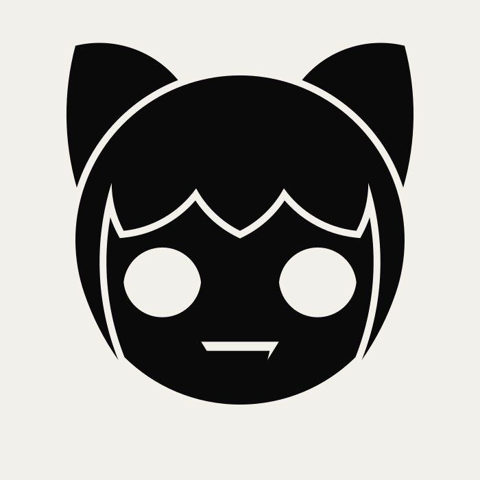

> A personal brand logo for a developer and video editor: a geometric cat that mixes Neco-Arc with the Superintendent from Halo 3: ODST, before running the skill.

</td>

<td width="50%" valign="top">

## After

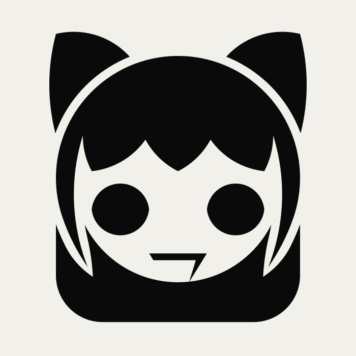

> The same logo after the skill's critique and the ruler-and-compass fit:
>
> 1. The face turns light, so the fringe is the edge between two tones instead of a thin gap that vanishes below 48 px.
> 2. The hair falls behind the head as a hood, built from the same golden series.
> 3. The fang becomes a 7, a wink to Bungie.
> 4. The gap around the hair widens to D7, so it still shows at 48 px.

</td>
</tr>
</table>

## Ruler and compass, step by step

Every curve of the *After* logo is an arc from one golden series, R(n) = 240 / φⁿ, and every distance is a step of it, D(n) = 2·R(n). Nothing is set by eye. The full method is in [`04-ruler-and-compass.md`](skills/rob-janoff-design/references/04-ruler-and-compass.md).

`R−1 388.3 · R0 240 · R1 148.3 · R2 91.7 · R3 56.7 · R4 35 · R5 21.6 · R6 13.4 · R7 8.3`

<table>
<tr>
<td width="33%" valign="top">
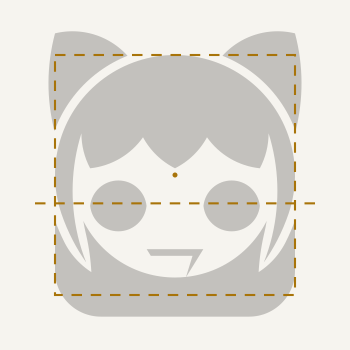
<br><strong>1 · Series and square</strong><br>
The head's square is 2·R0 = 480. Its golden section sets the eye line.
</td>
<td width="33%" valign="top">
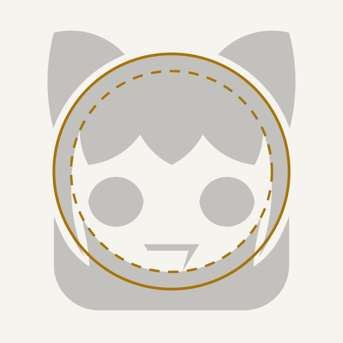
<br><strong>2 · Head and face</strong><br>
The head is R0 and the face R0 − R4. The hair falls behind and the face stands out against it.
</td>
<td width="33%" valign="top">
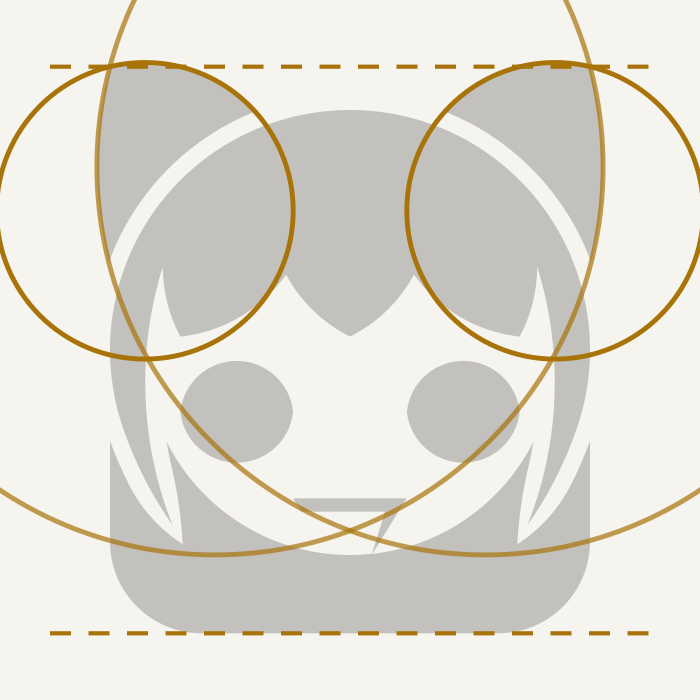
<br><strong>3 · Ears</strong><br>
Each ear is the lens between an R1 circle and an R−1 circle. The tip sits D5 above the square.
</td>
</tr>
<tr>
<td width="33%" valign="top">
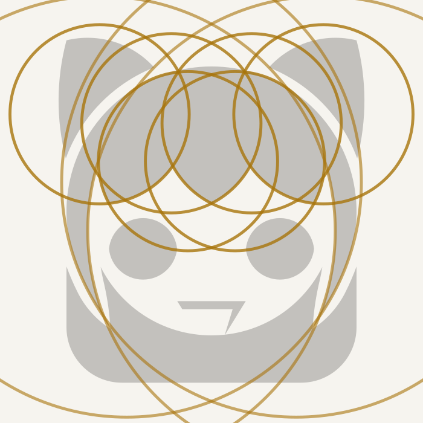
<br><strong>4 · Fringe and locks</strong><br>
Six R1 arcs draw the fringe. Four R−1 arcs, tangent to the head, draw the locks.
</td>
<td width="33%" valign="top">
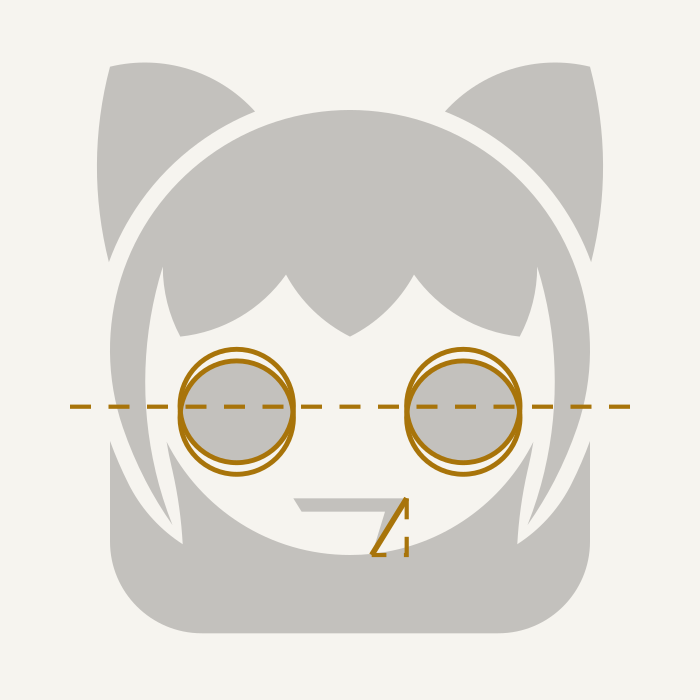
<br><strong>5 · Eyes and mouth</strong><br>
Each eye is where two R3 circles cross. The fang drops R3 and moves in R4: a φ slope that reads as a 7.
</td>
<td width="33%" valign="top">
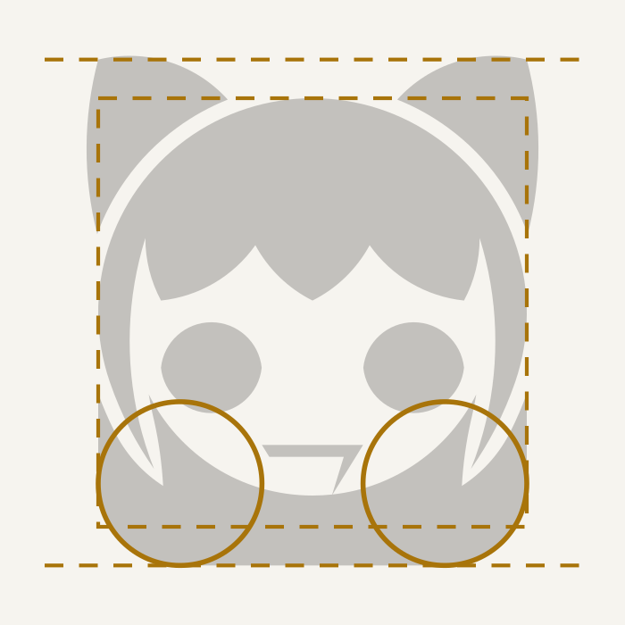
<br><strong>6 · Hood and frame</strong><br>
R2 corners and a bottom D5 below the square, the same D5 as the ears, so the margins match top and bottom.
</td>
</tr>
</table>

## From a sketch to three concepts

A second example, starting from a hand-drawn sketch ([@marsanwishito](https://www.tiktok.com/@marsanwishito)): a melancholic girl with a side fringe over one eye and a red heart on her chest, tied by a red thread to a poster. The brief was a T-shirt logo: vectorize her head and hair, imagine how the hair falls behind her head, then design. Each concept pulls a different detail out of the drawing.

<table>
<tr>
<td width="33%" valign="top">
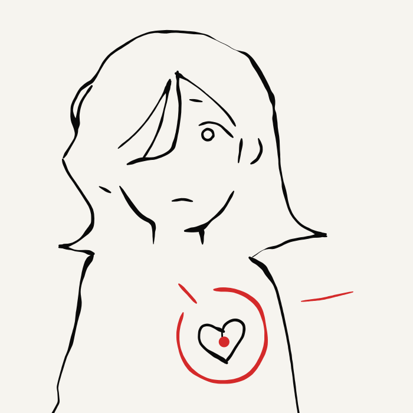
<br><strong>Reference</strong><br>
The sketch traced in vectors, keeping the pencil's width.
</td>
<td colspan="2" valign="top">
<strong>Three details, three concepts</strong>

1. **The fringe over one eye** becomes the cut of concept A.
2. **The heart on her chest** becomes the hair of concept B.
3. **The red thread** becomes the single line of concept C.

All three start from the same one-ink head: the hair is the mass and the face is the hole.
</td>
</tr>
<tr>
<td width="33%" valign="top">

<br><strong>A · Silhouette and cut</strong><br>
The fringe becomes a straight cut that leaves one eye. Every arc is a Fibonacci radius × 1.5 (89, 55, 13, 8, 3). At 16 px the head and the cut still read.
</td>
<td width="33%" valign="top">
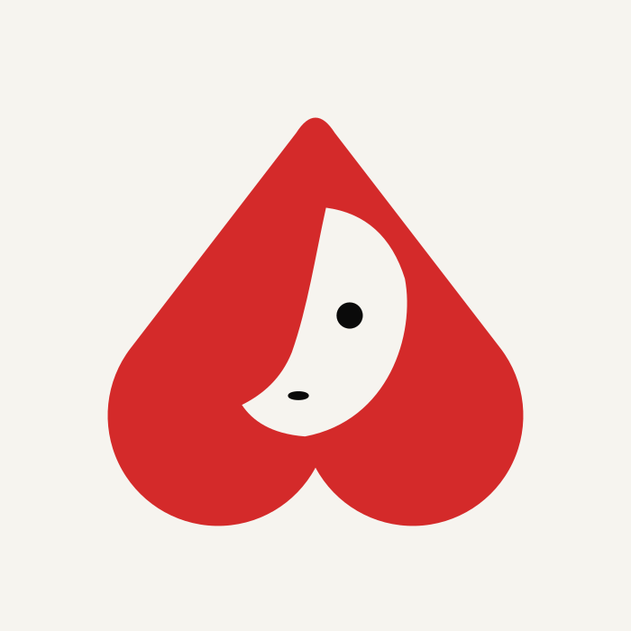
<br><strong>B · Negative-space wink</strong><br>
The heart on her chest becomes her hair: an upside-down heart with the face as its hole. Turn it 180° and the heart appears.
</td>
<td width="33%" valign="top">
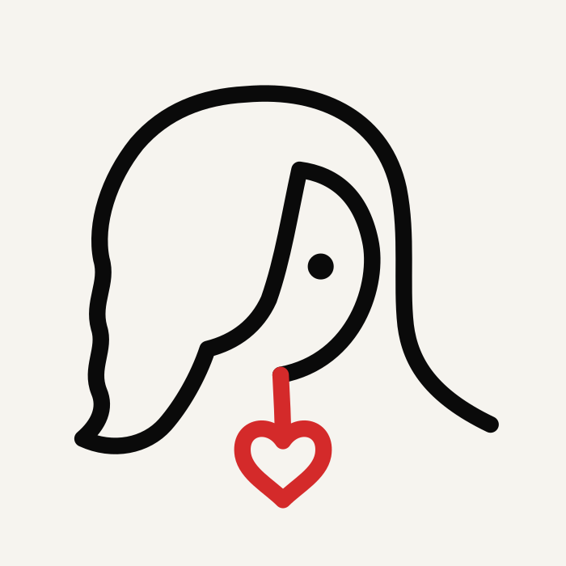
<br><strong>C · Graphic continuum</strong><br>
One line runs from the hair to the chin and turns into the red thread, ending in her heart. At 16 px the line breaks up, so an icon needs a simpler cut.
</td>
</tr>
</table>

## Usage

Ask your agent in plain words. The skill picks one of three modes:

| Mode | Example request | What you get |
| --- | --- | --- |
| Design | *"Design the logo for a specialty coffee shop in Oaxaca"* | Three one-ink concepts, then the full preview of the one you pick |
| Critique | *"Critique our logo: logo.svg"* | A verdict with evidence (renders, on-screen sizes) against Janoff's golden rules, nothing redrawn |
| Refresh | *"Refresh our logo, people already know it: logo.svg"* | Rebuild, refine and rethink-one-element options beside the original, like the cat above |

## Evals

`evals/` holds one case per mode (design, critique and refresh) for [`claude plugin eval`](https://code.claude.com/docs/en/plugin-evals.md). Each case runs with and without the skill, and graders score it: the commands the agent ran, the files it did or did not write, and an LLM judge for the message it ends with. The agent writes SVGs and runs Node, so the operator grants those tools:

```bash
claude plugin eval . --allow-tools Write Edit Bash "Bash(node *)" "Bash(mkdir *)"
```

Every run is a full agent session billed to your account; add `--runs 1` and `--max-cost-usd <usd>` to keep a check cheap. Results go to `evals/results/`, which git ignores.

## Repository layout

```
.
├── .claude-plugin/
│   ├── marketplace.json        # Claude Code plugin marketplace
│   └── plugin.json             # Plugin manifest
├── .github/workflows/test.yml   # CI: npm test and the type check on Linux, macOS and Windows
├── AGENTS.md                   # Install steps the agent follows
├── evals/                      # One claude plugin eval case per mode: design, critique, refresh
├── tests/                      # Tests for the skill's scripts: npm test
└── skills/
    └── rob-janoff-design/
        ├── SKILL.md            # Workflow the agent follows
        ├── references/         # Loaded on demand
        │   ├── 01-apple-process.md
        │   ├── 02-case-studies.md
        │   ├── 03-rules-and-typography.md
        │   └── 04-ruler-and-compass.md   # Golden-series construction, hand-edit fitting, tests
        ├── examples/           # Worked examples, also the README images
        │   ├── cat.md          # Critique and refresh of the cat, step by step with the series
        │   └── sketch-to-concepts.md     # Three different concepts from one sketch
        └── scripts/            # Node 24, no dependencies
            ├── series-audit.ts # Checks that every curve is an arc of the golden series
            ├── series-fit.ts   # Fits the client's hand-drawn edits back onto the series
            ├── scale-report.ts # On-screen size of every gap, shape and stroke at 256, 48 and 16 px
            └── render-png.ts   # PNGs at 256, 48 and 16 px and a sheet to look at before showing
```

## Disclaimer

Unofficial project, not affiliated with or endorsed by Rob Janoff. The references are original summaries of the book with short quotations; no text or files from the book are included.

## License

[MIT](LICENSE)
